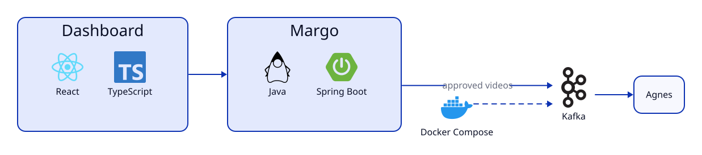

# Margo
- media ingest service
- full name: Media Asset Routing & Governance Orchestrator


## What's going on here

Margo is one of three small projects. Together, they pretend to be a video streaming service. Everything is simulated, so the "videos" and "ads" are just test patterns. But the pieces really do talk to each other.

- **Margo** (this one) checks new videos before anyone can watch them
- **[Edith](https://github.com/marlware/edith)** picks which ad to show and counts how many times each ad was seen
- **[Agnes](https://github.com/marlware/agnes)** streams the videos to viewers and plays the ads

## So what does Margo do

Margo is like a bouncer for the video library. Every new video gets checked at the door.

- It looks over each video's details
- It checks for a name, a real length, and a proper playlist file
- It stamps the video APPROVED if everything checks out
- It stamps the video REJECTED if not, along with a list of what was wrong

Then Margo announces the result on a message board (Kafka). Agnes listens to that board. That way, Agnes only streams videos that passed the check.

Two videos come pre-loaded, so there's something to look at right away.

- `demo` is a good one
- `broken` is a bad one

## The dashboard

The dashboard is a small web page. It shows what's happening in the library.

- Lists every video
- Shows whether each one passed
- Shows why any of them failed
- Refreshes itself every few seconds

So you can watch new videos show up while you run the stress test below.

## Why these technologies

- **Java and Spring Boot** make web services quick to build
- **Kafka** lets Margo announce results without knowing who's listening
- **React** keeps the dashboard up to date
- **TypeScript** catches mistakes before the page runs
- **Vite** gives the dashboard a fast dev server
- **Docker Compose** starts Kafka, Redis, and Flink in one command
- **Node** runs the stress test

Here's how the pieces connect.



## Trying it out

Here's what you'll need.

- Java
- Node
- Docker

Then do things in this order.

- Start the shared stuff with `docker compose up -d` (it runs the message board, Redis, and a Flink cluster for Edith)
- Start Margo with `./mvnw spring-boot:run` (it listens on port 8081)
- Start the dashboard with `cd dashboard && npm install && npm run dev`
- Open http://localhost:5173
- Add a video of your own with the command below, then leave out the title to watch it get rejected

```
curl -X POST localhost:8081/assets -H "content-type: application/json" \
  -d '{"id":"mine","title":"My Video","durationSeconds":20,"hlsPath":"/hls/mine/index.m3u8"}'
```

- Want the whole pretend service? Start Edith and then Agnes too (their READMEs have the steps)

## Stress test

Want to see Margo handle a crowd? Run `node scripts/load-assets.mjs`.

- Sends 10,000 videos through Margo
- Makes every tenth one broken on purpose
- Shows up on the dashboard as it runs
- Lets you check that Agnes heard about all of them

## Good to know

- Margo keeps its videos in memory, so a restart forgets anything you added
- The two starter videos always come back
- The compose file also runs Redis and Flink for Edith
- The Flink dashboard is at http://localhost:8083
- Kafka listens on two addresses, `localhost:9092` for programs on your computer and `kafka:19092` for containers
- The endpoints are `POST /assets`, `GET /assets`, and `GET /assets/{id}`
